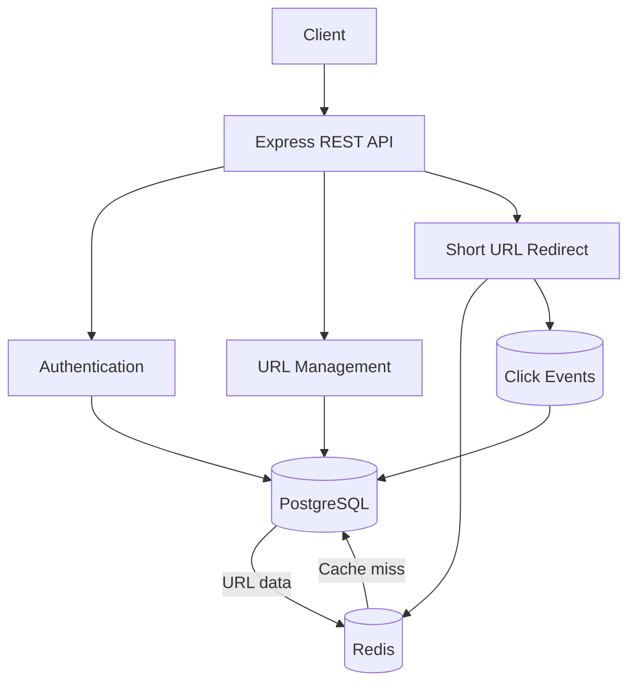

# LinkForge

LinkForge is a URL shortener backend built with Node.js, Express, PostgreSQL, Prisma, and Redis.

It provides authenticated URL management, short-link redirection, and click tracking through a REST API.

## Features

- User registration and login
- JWT-based authentication
- Create, list, update, and delete short URLs
- Redirect short links to their original URLs
- PostgreSQL persistence with Prisma ORM
- Redis caching for short-link lookups
- Click-event tracking
- Request validation with Zod
- Rate limiting for sensitive API endpoints
- Structured HTTP logging with Pino
- Centralized error handling
- Automated tests
- Docker and Docker Compose support

## Tech Stack

- Node.js
- Express
- PostgreSQL
- Prisma
- Redis
- Zod
- JSON Web Tokens
- bcryptjs
- Pino
- Docker
- Node.js built-in test runner
- Supertest

## Architecture



## Getting Started

### Prerequisites

- Node.js
- npm
- Docker
- Docker Compose
- Git

### Clone the repository

```bash
git clone https://github.com/sanitamartya/linkforge.git
cd linkforge
```

### Configure environment variables

Create your local environment file:

```bash
cp .env.example .env
```

Review `.env` and configure the values for your environment.

Important variables:

| Variable              | Purpose                                                |
| --------------------- | ------------------------------------------------------ |
| `NODE_ENV`            | Application environment                                |
| `PORT`                | API server port                                        |
| `APP_BASE_URL`        | Base URL used to generate short links                  |
| `POSTGRES_USER`       | PostgreSQL username                                    |
| `POSTGRES_PASSWORD`   | PostgreSQL password                                    |
| `POSTGRES_DB`         | PostgreSQL database name                               |
| `DATABASE_URL`        | Database connection for running the API outside Docker |
| `DATABASE_URL_DOCKER` | Database connection for the API inside Docker          |
| `REDIS_URL`           | Redis connection URL                                   |
| `JWT_SECRET`          | Secret used to sign JWTs                               |

Use a strong, unique JWT secret of at least 32 bytes. Do not commit your `.env` file or share production secrets.

### Run with Docker Compose

Build and start the application stack:

```bash
docker compose up --build -d
```

Check the running services:

```bash
docker compose ps
```

View application logs:

```bash
docker compose logs -f api
```

The API is available at:

```text
http://localhost:3000
```

The health endpoint is:

```text
GET http://localhost:3000/health
```

### Run the API locally

Start PostgreSQL and Redis using Docker Compose:

```bash
docker compose up -d db redis
```

Install dependencies:

```bash
npm install
```

Generate the Prisma client:

```bash
npm run prisma:generate
```

Apply database migrations:

```bash
npm run db:migrate:deploy
```

Start the development server:

```bash
npm run dev
```

## API Reference

Base URL:

```text
http://localhost:3000
```

Protected endpoints require an access token:

```text
Authorization: Bearer <accessToken>
```

### Health

| Method | Endpoint  | Description              |
| ------ | --------- | ------------------------ |
| GET    | `/health` | Check application health |

### Authentication

| Method | Endpoint                | Description                        |
| ------ | ----------------------- | ---------------------------------- |
| POST   | `/api/v1/auth/register` | Register a user                    |
| POST   | `/api/v1/auth/login`    | Log in and receive an access token |

#### Register

```bash
curl -X POST http://localhost:3000/api/v1/auth/register \
  -H "Content-Type: application/json" \
  -d '{
    "email": "user@example.com",
    "password": "strong-password"
  }'
```

Successful registration returns `201 Created`.

Email addresses are trimmed and normalized to lowercase. Passwords must contain at least 8 characters and must not exceed 72 bytes.

#### Login

```bash
curl -X POST http://localhost:3000/api/v1/auth/login \
  -H "Content-Type: application/json" \
  -d '{
    "email": "user@example.com",
    "password": "strong-password"
  }'
```

Successful login returns `200 OK` with user information and an access token.

Copy the returned token and use it for protected endpoints.

### URL Management

| Method | Endpoint           | Description                                   |
| ------ | ------------------ | --------------------------------------------- |
| POST   | `/api/v1/urls`     | Create a short URL                            |
| GET    | `/api/v1/urls`     | List URLs belonging to the authenticated user |
| PATCH  | `/api/v1/urls/:id` | Update a URL                                  |
| DELETE | `/api/v1/urls/:id` | Delete a URL                                  |

#### Create a short URL

```bash
curl -X POST http://localhost:3000/api/v1/urls \
  -H "Content-Type: application/json" \
  -H "Authorization: Bearer <accessToken>" \
  -d '{
    "originalUrl": "https://example.com"
  }'
```

Successful creation returns `201 Created`.

#### List your URLs

```bash
curl http://localhost:3000/api/v1/urls \
  -H "Authorization: Bearer <accessToken>"
```

#### Update a URL

Replace `<urlId>` with the URL's ID:

```bash
curl -X PATCH http://localhost:3000/api/v1/urls/<urlId> \
  -H "Content-Type: application/json" \
  -H "Authorization: Bearer <accessToken>" \
  -d '{
    "originalUrl": "https://example.org"
  }'
```

#### Delete a URL

```bash
curl -X DELETE http://localhost:3000/api/v1/urls/<urlId> \
  -H "Authorization: Bearer <accessToken>"
```

Successful deletion returns `204 No Content`.

### Short URL Redirection

| Method | Endpoint      | Description                  |
| ------ | ------------- | ---------------------------- |
| GET    | `/:shortCode` | Redirect to the original URL |

Example:

```bash
curl -I http://localhost:3000/<shortCode>
```

A valid short link returns a redirect response. An unknown short code returns `404 Not Found`.

## Testing

Run the test suite:

```bash
npm test
```

Run tests with coverage:

```bash
npm run test:coverage
```

The project uses Node.js's built-in test runner and Supertest for API testing.

## Security

- Passwords are hashed using bcryptjs.
- Authentication uses signed JWT access tokens.
- Protected URL operations are scoped to the authenticated user.
- Request bodies are validated using Zod.
- Only HTTP and HTTPS URLs are accepted.
- Helmet adds security-related HTTP headers.
- JSON request bodies are limited in size.
- Authentication and URL creation endpoints use rate limiting.
- Pino HTTP logging redacts sensitive authorization and cookie headers.

## Design Notes and Trade-offs

- PostgreSQL is the persistent source of URL and click-event data.
- Redis caches short-code lookups to reduce repeated database reads.
- Cached URL entries use a time-to-live of one hour.
- If Redis is unavailable, URL lookup falls back to PostgreSQL.
- Click-event recording is best-effort so tracking failures do not prevent redirection.
- Cache invalidation failures can leave stale entries until their cache TTL expires.

## Project Scripts

| Command                     | Description                                  |
| --------------------------- | -------------------------------------------- |
| `npm run dev`               | Start the development server with watch mode |
| `npm start`                 | Start the application                        |
| `npm test`                  | Run tests                                    |
| `npm run test:coverage`     | Run tests with coverage                      |
| `npm run prisma:generate`   | Generate the Prisma client                   |
| `npm run db:migrate:deploy` | Apply database migrations                    |

## Project Status

LinkForge is a portfolio project focused on backend engineering fundamentals and production-oriented practices, including authentication, persistence, caching, testing, security, and containerization.
